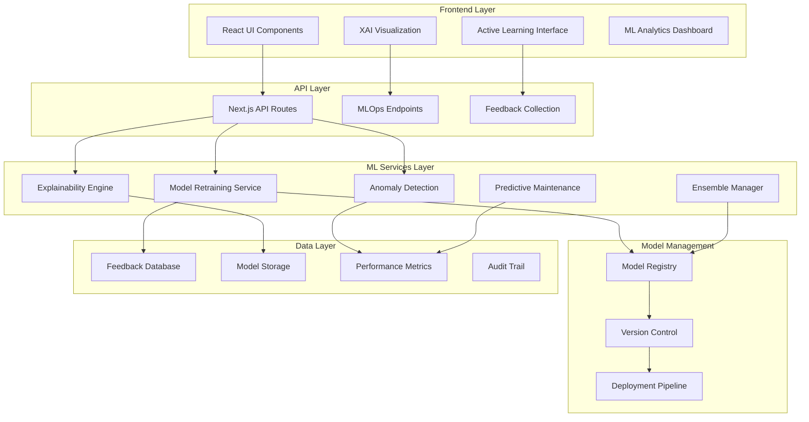

# Design Document

## Overview

The Advanced ML Features system extends the existing AI-driven NDT defect detection platform with enterprise-grade machine learning capabilities. The system will be built as a modular extension to the current Next.js/FastAPI architecture, adding sophisticated ML operations including active learning, explainable AI, anomaly detection, predictive maintenance, and automated model optimization. The design emphasizes production readiness, scalability, and seamless integration with the existing defect detection workflow.

## Architecture

### High-Level Architecture



### Technology Stack

- **Frontend**: Next.js 15, React 18, TypeScript, Recharts for ML metrics visualization
- **Backend**: Next.js API Routes, FastAPI for ML operations
- **ML Framework**: PyTorch, Ultralytics YOLO, scikit-learn
- **XAI Libraries**: GradCAM, LIME, SHAP
- **Model Management**: MLflow for experiment tracking and model registry
- **Anomaly Detection**: Isolation Forest, Autoencoder-based detection
- **Time Series**: Prophet for predictive maintenance forecasting
- **Database**: PostgreSQL for feedback and metrics, Redis for caching
- **Message Queue**: Bull/Redis for async ML operations
- **Monitoring**: Prometheus for model performance metrics

## Components and Interfaces

### Core Components

#### 1. Active Learning System
```typescript
interface ActiveLearningSystem {
  identifyUncertainPredictions(results: DetectionResult[]): UncertainPrediction[];
  prioritizeForReview(predictions: UncertainPrediction[]): ReviewQueue;
  collectFeedback(predictionId: string, feedback: UserFeedback): Promise<void>;
  triggerRetraining(threshold: number): Promise<RetrainingJob>;
}

interface UncertainPrediction {
  id: string;
  detectionResult: DetectionResult;
  uncertaintyScore: number;
  uncertaintyType: 'low_confidence' | 'high_variance' | 'boundary_case';
  recommendedAction: string;
}

interface UserFeedback {
  predictionId: string;
  userId: string;
  isCorrect: boolean;
  correctedLabel?: string;
  correctedBoundingBox?: BoundingBox;
  comments?: string;
  timestamp: Date;
}

interface ReviewQueue {
  items: UncertainPrediction[];
  totalCount: number;
  averageUncertainty: number;
  priorityOrder: 'uncertainty' | 'recency' | 'impact';
}
```

#### 2. Explainable AI Engine
```typescript
interface ExplainableAIEngine {
  generateGradCAM(image: ImageData, detection: Defect): Promise<GradCAMResult>;
  generateSaliencyMap(image: ImageData, detection: Defect): Promise<SaliencyMap>;
  explainPrediction(detection: Defect): ExplanationResult;
  visualizeAttention(image: ImageData, detection: Defect): Promise<AttentionVisualization>;
}

interface GradCAMResult {
  heatmap: ImageData;
  overlayImage: ImageData;
  attentionRegions: AttentionRegion[];
  confidence: number;
}

interface AttentionRegion {
  boundingBox: BoundingBox;
  importance: number; // 0-1 scale
  description: string;
}

interface ExplanationResult {
  topFeatures: Feature[];
  decisionPath: DecisionNode[];
  similarExamples: DetectionResult[];
  confidenceFactors: ConfidenceFactor[];
}

interface Feature {
  name: string;
  importance: number;
  value: number;
  description: string;
}
```

#### 3. Model Retraining Pipeline
```typescript
interface ModelRetrainingPipeline {
  evaluateRetrainingNeed(): Promise<RetrainingRecommendation>;
  prepareTrainingData(feedbackData: UserFeedback[]): Promise<TrainingDataset>;
  trainModel(config: TrainingConfig): Promise<TrainingJob>;
  validateModel(model: Model, testSet: TestDataset): Promise<ValidationResult>;
  deployModel(model: Model, validationResult: ValidationResult): Promise<DeploymentResult>;
}

interface TrainingConfig {
  baseModel: string;
  learningRate: number;
  epochs: number;
  batchSize: number;
  augmentation: AugmentationConfig;
  validationSplit: number;
}

interface ValidationResult {
  accuracy: number;
  precision: number;
  recall: number;
  f1Score: number;
  confusionMatrix: number[][];
  perClassMetrics: ClassMetrics[];
  comparisonWithCurrent: PerformanceComparison;
}

interface DeploymentResult {
  modelId: string;
  version: string;
  deployedAt: Date;
  previousVersion: string;
  rollbackAvailable: boolean;
  performanceImprovement: number;
}
```

#### 4. Anomaly Detection Engine
```typescript
interface AnomalyDetectionEngine {
  detectAnomalies(image: ImageData): Promise<AnomalyResult>;
  clusterAnomalies(anomalies: AnomalyResult[]): Promise<AnomalyCluster[]>;
  updateAnomalyModel(newData: ImageData[]): Promise<void>;
  calculateAnomalyScore(image: ImageData): Promise<number>;
}

interface AnomalyResult {
  id: string;
  isAnomaly: boolean;
  anomalyScore: number; // 0-1, higher = more anomalous
  anomalyType: 'novel_defect' | 'unusual_pattern' | 'out_of_distribution';
  reconstructionError?: number;
  nearestKnownDefect?: DefectType;
  similarityScore?: number;
}

interface AnomalyCluster {
  id: string;
  anomalies: AnomalyResult[];
  centroid: FeatureVector;
  averageScore: number;
  suggestedLabel?: string;
  requiresReview: boolean;
}
```

#### 5. Predictive Maintenance Module
```typescript
interface PredictiveMaintenanceModule {
  analyzeDefectProgression(componentId: string): Promise<ProgressionAnalysis>;
  predictFailureProbability(componentId: string): Promise<FailurePrediction>;
  generateMaintenanceRecommendations(predictions: FailurePrediction[]): MaintenanceSchedule;
  updatePredictiveModel(failureData: FailureEvent[]): Promise<void>;
}

interface ProgressionAnalysis {
  componentId: string;
  defectHistory: DefectSnapshot[];
  trend: 'improving' | 'stable' | 'degrading' | 'critical';
  rateOfChange: number;
  projectedTimeline: TimelineProjection[];
}

interface FailurePrediction {
  componentId: string;
  failureProbability: number; // 0-1
  confidenceInterval: [number, number];
  timeToFailure: {
    estimate: number; // days
    lowerBound: number;
    upperBound: number;
  };
  contributingFactors: Factor[];
  recommendedAction: 'monitor' | 'schedule_maintenance' | 'immediate_action';
}

interface MaintenanceSchedule {
  urgentComponents: ComponentMaintenance[];
  scheduledComponents: ComponentMaintenance[];
  monitoringComponents: ComponentMaintenance[];
  estimatedCostSavings: number;
}
```

#### 6. Model Drift Detection
```typescript
interface ModelDriftDetector {
  monitorPerformance(predictions: DetectionResult[]): Promise<PerformanceMetrics>;
  detectDrift(currentMetrics: PerformanceMetrics, baseline: PerformanceMetrics): DriftAnalysis;
  generateDriftReport(): Promise<DriftReport>;
  recommendActions(driftAnalysis: DriftAnalysis): DriftRecommendation[];
}

interface PerformanceMetrics {
  timestamp: Date;
  averageConfidence: number;
  detectionRate: number;
  falsePositiveRate: number;
  falseNegativeRate: number;
  processingTime: number;
  distributionStats: DistributionStats;
}

interface DriftAnalysis {
  isDrifting: boolean;
  driftSeverity: 'none' | 'minor' | 'moderate' | 'severe';
  driftType: 'concept_drift' | 'data_drift' | 'performance_drift';
  affectedClasses: string[];
  confidenceDrop: number;
  detectionRateChange: number;
  recommendRetraining: boolean;
}

interface DriftReport {
  period: DateRange;
  overallHealth: 'healthy' | 'warning' | 'critical';
  metrics: PerformanceMetrics[];
  driftEvents: DriftEvent[];
  recommendations: string[];
}
```

#### 7. Ensemble Model Manager
```typescript
interface EnsembleModelManager {
  registerModel(model: Model, weight: number): Promise<void>;
  runEnsemblePrediction(image: ImageData): Promise<EnsembleResult>;
  optimizeWeights(validationData: ValidationDataset): Promise<OptimizedWeights>;
  evaluateEnsemble(testData: TestDataset): Promise<EnsemblePerformance>;
}

interface EnsembleResult {
  finalPrediction: DetectionResult;
  individualPredictions: ModelPrediction[];
  consensus: number; // 0-1, agreement level
  disagreements: Disagreement[];
  confidenceAdjustment: number;
}

interface ModelPrediction {
  modelId: string;
  modelVersion: string;
  prediction: DetectionResult;
  weight: number;
  processingTime: number;
}

interface EnsemblePerformance {
  accuracy: number;
  improvementOverBest: number;
  consensusRate: number;
  disagreementRate: number;
  recommendEnsemble: boolean;
}
```

## Data Models

### Feedback and Training Data
```typescript
interface FeedbackRecord {
  id: string;
  userId: string;
  detectionResultId: string;
  originalPrediction: DetectionResult;
  feedback: UserFeedback;
  imageData: string; // Base64 or storage URL
  metadata: FeedbackMetadata;
  usedInTraining: boolean;
  trainingJobId?: string;
  createdAt: Date;
}

interface TrainingDataset {
  id: string;
  name: string;
  version: string;
  images: TrainingImage[];
  split: {
    train: number;
    validation: number;
    test: number;
  };
  statistics: DatasetStatistics;
  createdAt: Date;
}

interface TrainingImage {
  id: string;
  imageUrl: string;
  annotations: Annotation[];
  source: 'initial_training' | 'user_feedback' | 'active_learning';
  quality: number; // 0-1
  metadata: ImageMetadata;
}
```

### Model Registry
```typescript
interface ModelRecord {
  id: string;
  name: string;
  version: string;
  architecture: string;
  framework: 'pytorch' | 'tensorflow' | 'onnx';
  modelPath: string;
  configPath: string;
  trainingJob: TrainingJobReference;
  performance: ModelPerformance;
  status: 'training' | 'validating' | 'deployed' | 'archived' | 'failed';
  deployedAt?: Date;
  createdAt: Date;
  createdBy: string;
}

interface ModelPerformance {
  accuracy: number;
  precision: number;
  recall: number;
  f1Score: number;
  inferenceTime: number; // milliseconds
  modelSize: number; // bytes
  perClassMetrics: Record<string, ClassMetrics>;
}

interface TrainingJobReference {
  jobId: string;
  datasetId: string;
  config: TrainingConfig;
  duration: number; // seconds
  epochs: number;
  finalLoss: number;
}
```

### Anomaly Detection Data
```typescript
interface AnomalyRecord {
  id: string;
  imageId: string;
  anomalyScore: number;
  anomalyType: string;
  detectedAt: Date;
  reviewed: boolean;
  reviewedBy?: string;
  assignedLabel?: string;
  clusterId?: string;
  features: FeatureVector;
}

interface FeatureVector {
  embedding: number[];
  dimensionality: number;
  extractionMethod: string;
}
```

### Predictive Maintenance Data
```typescript
interface ComponentHistory {
  componentId: string;
  componentType: string;
  installDate: Date;
  inspections: InspectionRecord[];
  defectProgression: DefectSnapshot[];
  maintenanceEvents: MaintenanceEvent[];
  failureEvents: FailureEvent[];
}

interface DefectSnapshot {
  timestamp: Date;
  detectionResult: DetectionResult;
  defectCount: number;
  severityDistribution: Record<DefectSeverity, number>;
  affectedArea: number;
}

interface FailureEvent {
  timestamp: Date;
  failureType: string;
  rootCause?: string;
  precedingDefects: DefectSnapshot[];
  downtime: number; // hours
  repairCost: number;
}
```

## Error Handling

### Error Categories and Handling Strategy

#### 1. Model Training Errors
- **Insufficient Data**: Require minimum 20 examples per class, suggest data augmentation
- **Training Divergence**: Implement early stopping and learning rate scheduling
- **Validation Failure**: Reject model deployment, maintain current version
- **Resource Exhaustion**: Queue training jobs, implement batch size reduction

#### 2. Explainability Errors
- **GradCAM Generation Failure**: Fallback to saliency maps or feature importance
- **Visualization Rendering**: Provide text-based explanations as backup
- **Memory Issues**: Reduce image resolution for explanation generation

#### 3. Anomaly Detection Errors
- **Model Not Initialized**: Train initial anomaly model with baseline data
- **High False Positive Rate**: Adjust anomaly threshold dynamically
- **Clustering Failure**: Fall back to individual anomaly review

#### 4. Predictive Maintenance Errors
- **Insufficient Historical Data**: Require minimum 30 days of inspection history
- **Prediction Uncertainty**: Provide wide confidence intervals, recommend monitoring
- **Model Drift**: Retrain with recent failure data

### Error Recovery Mechanisms
```typescript
interface MLErrorHandler {
  handleTrainingError(error: TrainingError): ErrorRecovery;
  handlePredictionError(error: PredictionError): ErrorRecovery;
  handleDeploymentError(error: DeploymentError): ErrorRecovery;
  rollbackModel(modelId: string): Promise<RollbackResult>;
}

interface ErrorRecovery {
  action: 'retry' | 'fallback' | 'rollback' | 'alert';
  message: string;
  retryAfter?: number;
  fallbackStrategy?: string;
  requiresIntervention: boolean;
}
```


## Correctness Properties

*A property is a characteristic or behavior that should hold true across all valid executions of a system-essentially, a formal statement about what the system should do. Properties serve as the bridge between human-readable specifications and machine-verifiable correctness guarantees.*

### Active Learning and Model Retraining Properties

Property 1: Feedback storage round trip
*For any* user feedback submission, storing the feedback and then querying it from the database should return equivalent feedback data with matching image and metadata
**Validates: Requirements 1.1**

Property 2: Retraining trigger at threshold
*For any* sequence of feedback additions, when the count reaches exactly 100 new labeled examples, a retraining evaluation job should be created
**Validates: Requirements 1.2**

Property 3: Model validation before deployment
*For any* retraining job, the deployment workflow should include a validation step against a holdout test set before the model is marked as deployed
**Validates: Requirements 1.3**

Property 4: Previous model version preservation
*For any* model deployment, the model registry should contain the previous version with status 'archived' and rollback capability enabled
**Validates: Requirements 1.4**

Property 5: Performance-based deployment rejection
*For any* model validation where new model metrics are worse than current model metrics, the deployment should be rejected and an administrator alert should be generated
**Validates: Requirements 1.5**

### Explainable AI Properties

Property 6: GradCAM generation for all detections
*For any* defect detection result, a GradCAM heatmap should be generated highlighting the influential image regions
**Validates: Requirements 2.1**

Property 7: Explanation overlay presence
*For any* detection result rendering, the output should include visual explanation overlays showing attention regions
**Validates: Requirements 2.2**

Property 8: Low confidence automatic explanation
*For any* detection with confidence score below 80%, the generated report should automatically include explanation visualizations
**Validates: Requirements 2.4**

Property 9: Individual explanations for multiple defects
*For any* detection result containing N defects, the system should generate exactly N individual explanations
**Validates: Requirements 2.5**

### Active Learning and Uncertainty Properties

Property 10: Uncertainty score calculation
*For any* detection result, an uncertainty score should be calculated and stored with the result
**Validates: Requirements 3.1**

Property 11: High uncertainty flagging
*For any* detection where uncertainty exceeds the configured threshold, the result should be flagged for active learning review
**Validates: Requirements 3.2**

Property 12: Uncertainty-based queue ordering
*For any* active learning review queue, the items should be ordered by uncertainty score in descending order
**Validates: Requirements 3.3**

Property 13: Uncertain feedback prioritization
*For any* feedback provided on uncertain predictions, the training priority score should be higher than feedback on confident predictions
**Validates: Requirements 3.4**

Property 14: Queue threshold retraining trigger
*For any* active learning queue, when the size reaches 50 items, an automated retraining cycle should be initiated
**Validates: Requirements 3.5**

### Anomaly Detection Properties

Property 15: Parallel anomaly detection
*For any* image processing request, both standard defect classification results and anomaly detection results should be produced
**Validates: Requirements 4.1**

Property 16: Anomaly labeling consistency
*For any* detected anomaly, the result should include an "unknown defect" label and a valid anomaly confidence score
**Validates: Requirements 4.2**

Property 17: Anomaly clustering
*For any* set of detected anomalies, similar anomalies should be grouped into clusters based on feature similarity
**Validates: Requirements 4.3**

Property 18: Anomaly labeling updates taxonomy
*For any* user-labeled anomaly, the defect taxonomy should be updated to either include a new category or map to an existing one
**Validates: Requirements 4.4**

Property 19: High anomaly rate alerting
*For any* processing batch where anomaly detection rate exceeds 5%, an administrator alert should be generated indicating potential model drift
**Validates: Requirements 4.5**

### Predictive Maintenance Properties

Property 20: Temporal pattern analysis
*For any* component with historical defect data, the system should perform temporal pattern analysis and generate defect progression metrics
**Validates: Requirements 5.1**

Property 21: Failure prediction generation
*For any* component type with sufficient historical data (minimum 30 days), failure probability predictions should be generated
**Validates: Requirements 5.2**

Property 22: High probability maintenance recommendation
*For any* component with failure probability exceeding 70%, the system should generate an immediate maintenance or replacement recommendation
**Validates: Requirements 5.3**

Property 23: Prediction completeness
*For any* failure prediction, the result should include confidence intervals and time-to-failure estimates with lower and upper bounds
**Validates: Requirements 5.4**

Property 24: Low accuracy retraining trigger
*For any* predictive model where accuracy falls below 75%, a retraining job should be initiated with recent failure data
**Validates: Requirements 5.5**

### Model Drift Detection Properties

Property 25: Metrics logging for all processing
*For any* image processing batch, prediction confidence distributions and detection rates should be logged to the metrics database
**Validates: Requirements 6.1**

Property 26: Baseline comparison in analysis
*For any* performance analysis, the results should include a comparison between current metrics and baseline metrics
**Validates: Requirements 6.2**

Property 27: Drift detection alerting
*For any* detected model drift, an administrator alert should be generated including specific performance degradation metrics
**Validates: Requirements 6.3**

Property 28: Drift alert includes retraining recommendation
*For any* drift alert, the alert should include a recommendation to retrain with recent data
**Validates: Requirements 6.4**

Property 29: Confidence drop evaluation trigger
*For any* metric analysis where average confidence drops by more than 10% from baseline, a model evaluation should be automatically initiated
**Validates: Requirements 6.5**

### Threshold Optimization Properties

Property 30: FP/FN rate tracking per component type
*For any* batch of processed components, false positive and false negative rates should be tracked separately for each component type
**Validates: Requirements 7.1**

Property 31: ROC-based threshold calculation
*For any* component type with sufficient feedback data, optimal confidence thresholds should be calculated using ROC curve analysis
**Validates: Requirements 7.2**

Property 32: Threshold adjustment recommendations
*For any* calculated optimal threshold, a recommendation should be generated for administrators to review and approve
**Validates: Requirements 7.3**

Property 33: Automatic threshold application
*For any* approved threshold update, the corresponding component profile should be automatically updated with the new threshold value
**Validates: Requirements 7.4**

Property 34: High FP rate threshold increase
*For any* component type where false positive rate exceeds 15%, the confidence threshold should be automatically increased
**Validates: Requirements 7.5**

### Transfer Learning Properties

Property 35: Transfer learning support for new defects
*For any* new defect type introduction, the system should support initializing a classifier using transfer learning from existing models
**Validates: Requirements 8.1**

Property 36: Minimum training data requirement
*For any* new defect type training request with fewer than 20 labeled examples, the training should be rejected with a request for more data
**Validates: Requirements 8.2**

Property 37: Knowledge preservation during fine-tuning
*For any* model fine-tuned on new materials, the detection accuracy on existing defect types should not decrease by more than 5%
**Validates: Requirements 8.3**

Property 38: Transfer learning validation requirement
*For any* transfer learning job, the workflow should include validation on a test set before the adapted model is deployed
**Validates: Requirements 8.4**

Property 39: Low accuracy additional data request
*For any* transfer learning result with accuracy below 85%, the system should generate a request for additional training examples
**Validates: Requirements 8.5**

### Ensemble Model Properties

Property 40: Ensemble model limit
*For any* ensemble configuration, the system should support combining up to 5 models and reject configurations with more than 5 models
**Validates: Requirements 9.1**

Property 41: Weighted voting aggregation
*For any* ensemble prediction, the final result should be computed using weighted voting based on individual model performance metrics
**Validates: Requirements 9.2**

Property 42: Disagreement flagging
*For any* ensemble prediction where model consensus is below 70%, the detection should be flagged for manual review
**Validates: Requirements 9.3**

Property 43: Ensemble result completeness
*For any* ensemble prediction result, all individual model predictions and the final consensus should be included in the output
**Validates: Requirements 9.4**

Property 44: Ensemble recommendation based on performance
*For any* ensemble configuration where accuracy exceeds the best single model by 5% or more, the system should recommend ensemble mode as default
**Validates: Requirements 9.5**

### AI Governance and Audit Properties

Property 45: Training audit logging
*For any* model training job, the audit log should contain training data sources, hyperparameters, and performance metrics
**Validates: Requirements 10.1**

Property 46: Deployment metadata recording
*For any* model deployment, the registry should record deployment timestamp, version number, and approval workflow information
**Validates: Requirements 10.2**

Property 47: Audit report completeness
*For any* generated audit report, the report should include complete model lineage and performance history
**Validates: Requirements 10.3**

Property 48: Model card inclusion in exports
*For any* audit data export, the export should include model cards documenting intended use and limitations
**Validates: Requirements 10.4**

Property 49: Training data export capability
*For any* export request, the system should support exporting training data and model artifacts for external validation
**Validates: Requirements 10.5**

## Testing Strategy

### Unit Testing

Unit tests will focus on individual components and functions:

- **Feedback Collection**: Test feedback storage, retrieval, and validation
- **Uncertainty Calculation**: Test uncertainty score computation algorithms
- **GradCAM Generation**: Test heatmap generation with mock models
- **Anomaly Detection**: Test anomaly scoring and clustering algorithms
- **Threshold Optimization**: Test ROC curve analysis and threshold calculation
- **Model Registry**: Test CRUD operations and version management
- **Drift Detection**: Test metric comparison and drift identification logic

### Property-Based Testing

Property-based tests will verify universal properties across all inputs using **Hypothesis** for Python and **fast-check** for TypeScript:

- **Property Testing Framework**: Hypothesis (Python), fast-check (TypeScript)
- **Test Iterations**: Minimum 100 iterations per property test
- **Property Test Tagging**: Each test must reference the design document property using format: `**Feature: advanced-ml-features, Property {number}: {property_text}**`
- **Single Property Per Test**: Each correctness property must be implemented by exactly one property-based test

Key property tests include:

- **Feedback Round Trip**: Test that storing and retrieving feedback preserves all data
- **Threshold Triggers**: Test that various thresholds correctly trigger actions
- **Model Validation**: Test that validation logic correctly accepts/rejects models
- **Uncertainty Ordering**: Test that queues are always sorted by uncertainty
- **Ensemble Aggregation**: Test that weighted voting produces correct results
- **Drift Detection**: Test that performance degradation is correctly identified

### Integration Testing

Integration tests will verify end-to-end workflows:

- **Active Learning Workflow**: User feedback → storage → retraining trigger → model deployment
- **XAI Pipeline**: Detection → GradCAM generation → visualization rendering
- **Anomaly Detection Flow**: Image processing → anomaly detection → clustering → review
- **Predictive Maintenance**: Historical data → pattern analysis → failure prediction → recommendations
- **Model Deployment**: Training → validation → registry update → deployment → rollback capability

### Performance Testing

Performance benchmarks for ML operations:

- **GradCAM Generation**: < 500ms per detection
- **Uncertainty Calculation**: < 100ms per detection
- **Anomaly Detection**: < 200ms per image
- **Ensemble Prediction**: < 2 seconds for 5 models
- **Model Training**: Complete within 2 hours for 1000 images
- **Drift Analysis**: Process 10,000 predictions in < 5 seconds

### Test Data Strategy

- **Synthetic Defect Images**: Generate images with known defects for controlled testing
- **Feedback Simulation**: Create realistic user feedback patterns
- **Historical Data**: Use time-series data for predictive maintenance testing
- **Model Variants**: Create multiple model versions for ensemble and drift testing
- **Edge Cases**: Test boundary conditions (exactly 100 feedback items, exactly 5 models, etc.)

### Continuous Integration

- **Automated Testing**: Run full test suite on every commit
- **Model Validation**: Automatically validate model performance on test set
- **Performance Regression**: Track and alert on performance degradation
- **Security Scanning**: Scan for vulnerabilities in ML dependencies
- **Code Quality**: Enforce type safety and linting standards

The testing strategy ensures that all advanced ML features work correctly, maintain high performance, and integrate seamlessly with the existing defect detection system.
