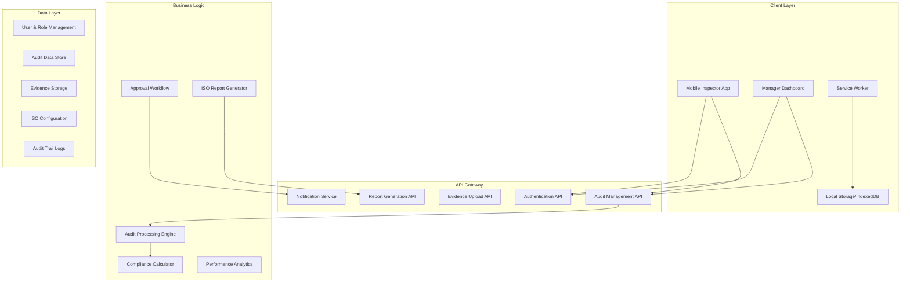
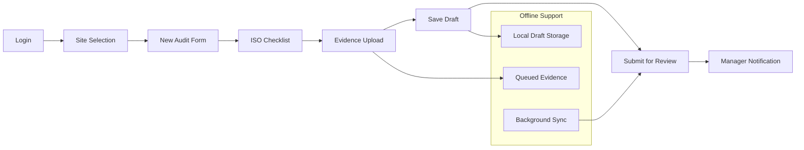
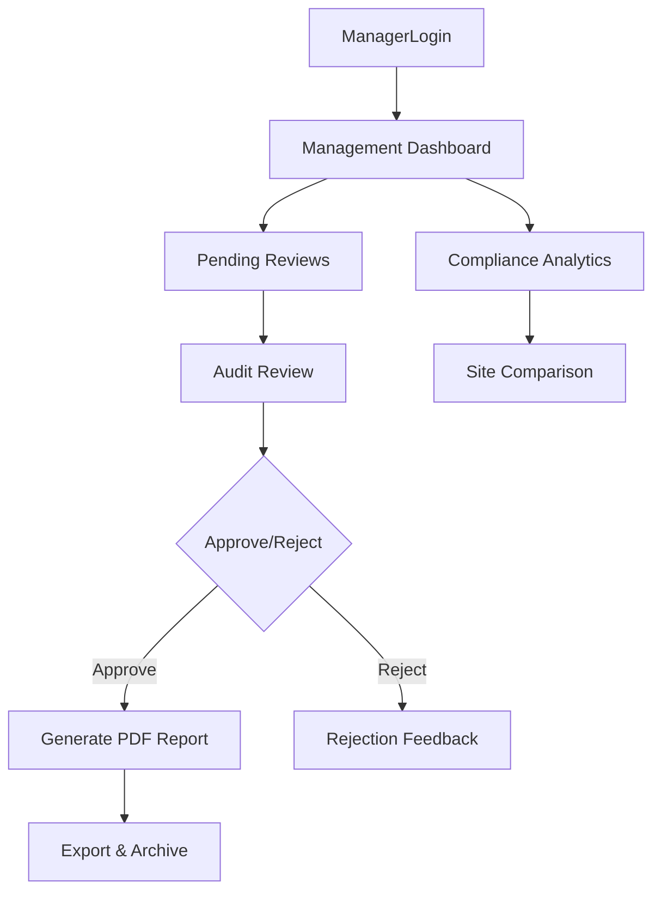

# Design Document

## Overview

The ISO Audit Dashboard system transforms paper-based compliance processes into a digital workflow optimized for mobile field work and desktop management. The system features role-specific interfaces for Inspectors (mobile-first audit forms) and Managers (desktop dashboard for approvals), with automated PDF generation following ISO 9001 standards. The architecture emphasizes offline capability, real-time collaboration, and standardized reporting to ensure regulatory compliance and audit trail integrity.

## Architecture

### High-Level System Architecture



### Role-Specific Architecture

#### Inspector Mobile Interface


#### Manager Dashboard Interface


## Components and Interfaces

### Core System Components

#### 1. Audit Form Engine
```typescript
interface AuditFormEngine {
  loadChecklist: (isoVersion: string) => Promise<ISOChecklist>;
  validateResponse: (item: ChecklistItem, response: AuditResponse) => ValidationResult;
  calculateProgress: (responses: AuditResponse[]) => ProgressStatus;
  saveAsDraft: (audit: AuditDraft) => Promise<string>;
  submitForReview: (auditId: string) => Promise<SubmissionResult>;
}

interface ISOChecklist {
  version: string;
  sections: ChecklistSection[];
  totalItems: number;
  requiredItems: string[];
}

interface ChecklistSection {
  id: string;
  title: string;
  isoClause: string;
  items: ChecklistItem[];
  weight: number;
}

interface ChecklistItem {
  id: string;
  question: string;
  isoReference: string;
  responseType: 'pass_fail' | 'pass_fail_na' | 'numeric' | 'text';
  required: boolean;
  helpText: string;
  correctiveActionTemplates: string[];
}
```

#### 2. Evidence Management System
```typescript
interface EvidenceManager {
  uploadEvidence: (file: File, auditItemId: string) => Promise<EvidenceRecord>;
  compressImage: (file: File) => Promise<File>;
  validateFileType: (file: File) => boolean;
  generateThumbnail: (imageFile: File) => Promise<string>;
  queueOfflineUpload: (file: File, metadata: EvidenceMetadata) => void;
}

interface EvidenceRecord {
  id: string;
  auditItemId: string;
  filename: string;
  fileType: 'photo' | 'video' | 'document';
  url: string;
  thumbnailUrl?: string;
  uploadedAt: Date;
  fileSize: number;
}

interface EvidenceMetadata {
  auditId: string;
  itemId: string;
  capturedAt: Date;
  location?: GeolocationCoordinates;
  deviceInfo: string;
}
```

#### 3. Workflow Management Engine
```typescript
interface WorkflowEngine {
  submitAudit: (auditId: string, submitterId: string) => Promise<WorkflowResult>;
  assignReviewer: (auditId: string, managerId: string) => Promise<void>;
  approveAudit: (auditId: string, approverId: string, comments: string) => Promise<ApprovalResult>;
  rejectAudit: (auditId: string, rejectorId: string, feedback: string) => Promise<RejectionResult>;
  getWorkflowStatus: (auditId: string) => Promise<WorkflowStatus>;
}

interface WorkflowStatus {
  currentState: 'draft' | 'submitted' | 'in_review' | 'approved' | 'rejected';
  assignedReviewer?: string;
  submittedAt?: Date;
  reviewedAt?: Date;
  comments: WorkflowComment[];
  nextActions: string[];
}

interface WorkflowComment {
  id: string;
  userId: string;
  userName: string;
  comment: string;
  timestamp: Date;
  action: 'submit' | 'approve' | 'reject' | 'request_changes';
}
```

#### 4. Compliance Calculator
```typescript
interface ComplianceCalculator {
  calculateAuditScore: (responses: AuditResponse[]) => ComplianceScore;
  calculateSiteScore: (audits: AuditRecord[], timeframe: DateRange) => SiteComplianceScore;
  generateBenchmark: (sites: string[], timeframe: DateRange) => BenchmarkData;
  identifyTrends: (scores: ComplianceScore[], period: 'weekly' | 'monthly') => TrendAnalysis;
}

interface ComplianceScore {
  overallScore: number; // 0-100%
  sectionScores: Record<string, number>;
  passedItems: number;
  totalItems: number;
  criticalFailures: number;
  improvementAreas: string[];
}

interface BenchmarkData {
  sites: SiteBenchmark[];
  industryAverage?: number;
  bestPractices: string[];
  recommendations: string[];
}

interface SiteBenchmark {
  siteId: string;
  siteName: string;
  currentScore: number;
  previousScore: number;
  trend: 'improving' | 'declining' | 'stable';
  ranking: number;
}
```

#### 5. ISO Report Generator
```typescript
interface ISOReportGenerator {
  generateStandardReport: (auditId: string) => Promise<ReportDocument>;
  generateBenchmarkReport: (sites: string[], timeframe: DateRange) => Promise<ReportDocument>;
  exportToPDF: (report: ReportDocument) => Promise<Blob>;
  exportToCSV: (audits: AuditRecord[]) => Promise<Blob>;
  emailReport: (reportBlob: Blob, recipients: string[]) => Promise<boolean>;
}

interface ReportDocument {
  id: string;
  title: string;
  generatedAt: Date;
  auditMetadata: AuditMetadata;
  executiveSummary: ExecutiveSummary;
  findings: Finding[];
  correctiveActions: CorrectiveAction[];
  evidence: EvidenceReference[];
  isoMapping: ISOClauseMapping[];
  approvalSection: ApprovalSection;
}

interface Finding {
  id: string;
  isoClause: string;
  description: string;
  severity: 'critical' | 'major' | 'minor' | 'observation';
  status: 'open' | 'closed' | 'in_progress';
  evidenceIds: string[];
  correctiveActionId?: string;
}
```

### User Interface Components

#### 1. Mobile Inspector Interface
```typescript
interface InspectorMobileProps {
  user: InspectorUser;
  currentAudit?: AuditDraft;
  onAuditComplete: (audit: CompletedAudit) => void;
}

interface ChecklistFormProps {
  checklist: ISOChecklist;
  responses: AuditResponse[];
  onResponseChange: (itemId: string, response: AuditResponse) => void;
  onEvidenceUpload: (itemId: string, file: File) => void;
  offline: boolean;
}

interface EvidenceUploadProps {
  itemId: string;
  existingEvidence: EvidenceRecord[];
  onUpload: (file: File) => Promise<void>;
  maxFileSize: number;
  acceptedTypes: string[];
}
```

#### 2. Manager Dashboard Interface
```typescript
interface ManagerDashboardProps {
  user: ManagerUser;
  pendingAudits: AuditSummary[];
  complianceMetrics: ComplianceMetrics;
  onAuditReview: (auditId: string) => void;
}

interface AuditReviewProps {
  audit: DetailedAudit;
  onApprove: (comments: string) => Promise<void>;
  onReject: (feedback: string) => Promise<void>;
  onRequestChanges: (changes: string[]) => Promise<void>;
}

interface ComplianceDashboardProps {
  sites: SiteBenchmark[];
  timeframe: DateRange;
  onSiteSelect: (siteId: string) => void;
  onExportReport: (format: 'pdf' | 'csv') => void;
}
```

## Data Models

### Core Audit Data Model
```typescript
interface AuditRecord {
  id: string;
  siteId: string;
  inspectorId: string;
  managerId?: string;
  
  // Metadata
  auditDate: Date;
  shift: 'day' | 'night' | 'weekend';
  auditType: 'routine' | 'incident' | 'follow_up';
  pdcaStage: 'plan' | 'do' | 'check' | 'act';
  
  // Status tracking
  status: AuditStatus;
  submittedAt?: Date;
  reviewedAt?: Date;
  approvedAt?: Date;
  
  // Content
  responses: AuditResponse[];
  evidence: EvidenceRecord[];
  complianceScore?: ComplianceScore;
  
  // Workflow
  workflowHistory: WorkflowEvent[];
  comments: WorkflowComment[];
}

interface AuditResponse {
  itemId: string;
  isoClause: string;
  response: 'pass' | 'fail' | 'na';
  numericValue?: number;
  textResponse?: string;
  comments?: string;
  severity?: 'low' | 'medium' | 'high' | 'critical';
  correctiveAction?: string;
  targetCloseDate?: Date;
  evidenceIds: string[];
}

interface Site {
  id: string;
  name: string;
  location: string;
  organizationId: string;
  timezone: string;
  contactInfo: ContactInfo;
  certifications: string[];
  lastAuditDate?: Date;
}

interface User {
  id: string;
  email: string;
  name: string;
  role: 'inspector' | 'manager' | 'admin';
  organizationId: string;
  assignedSites: string[];
  preferences: UserPreferences;
  lastLoginAt?: Date;
}
```

### Offline Data Model
```typescript
interface OfflineAuditData {
  drafts: AuditDraft[];
  pendingUploads: PendingUpload[];
  cachedChecklists: ISOChecklist[];
  userProfile: User;
  siteData: Site[];
  lastSyncAt: Date;
}

interface PendingUpload {
  id: string;
  auditId: string;
  itemId: string;
  file: Blob;
  metadata: EvidenceMetadata;
  retryCount: number;
  createdAt: Date;
}
```

## Error Handling

### Offline/Connectivity Error Handling
```typescript
interface OfflineHandler {
  detectConnectivity: () => boolean;
  queueOfflineActions: (action: OfflineAction) => void;
  syncWhenOnline: () => Promise<SyncResult>;
  handleSyncConflicts: (conflicts: DataConflict[]) => Promise<void>;
}

interface ConnectivityErrorHandler {
  handleUploadFailure: (file: File, error: Error) => void;
  handleSyncFailure: (data: any, error: Error) => void;
  showOfflineIndicator: () => void;
  retryWithBackoff: (operation: () => Promise<any>, maxRetries: number) => Promise<any>;
}
```

### Validation Error Handling
```typescript
interface ValidationErrorHandler {
  validateAuditCompleteness: (audit: AuditDraft) => ValidationResult;
  validateEvidenceRequirements: (responses: AuditResponse[]) => ValidationResult;
  handleMissingRequiredFields: (missingFields: string[]) => void;
  suggestCorrections: (errors: ValidationError[]) => string[];
}
```

## Testing Strategy

### Mobile Testing Strategy
- **Device Testing**: iOS/Android tablets and phones across different screen sizes
- **Offline Testing**: Network interruption scenarios and sync recovery
- **Performance Testing**: Large file uploads and form responsiveness
- **Touch Interface**: Gesture recognition and accessibility compliance

### Workflow Testing
- **Role-Based Testing**: Inspector, Manager, and Admin user journeys
- **State Transition Testing**: Draft → Submit → Review → Approve/Reject flows
- **Notification Testing**: In-app and email notification delivery
- **Concurrent Access**: Multiple users working on same audit data

### Compliance Testing
- **ISO Mapping Validation**: Ensure all checklist items map to correct ISO clauses
- **Report Format Testing**: PDF output matches ISO 9001 requirements
- **Audit Trail Testing**: Complete logging of all user actions and changes
- **Data Integrity**: Prevent data loss during offline/online transitions

### Integration Testing
```typescript
interface TestSuite {
  testAuditWorkflow: () => Promise<void>; // End-to-end audit creation to approval
  testOfflineSync: () => Promise<void>; // Offline draft creation and sync
  testReportGeneration: () => Promise<void>; // PDF generation and export
  testRolePermissions: () => Promise<void>; // Access control validation
  testComplianceCalculation: () => Promise<void>; // Score calculation accuracy
}
```

The design ensures a robust, user-friendly system that maintains ISO compliance while providing efficient digital workflows for field inspectors and management oversight.