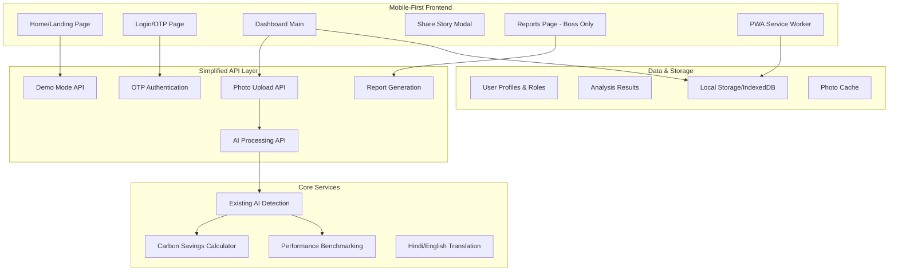
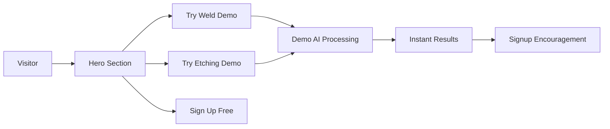
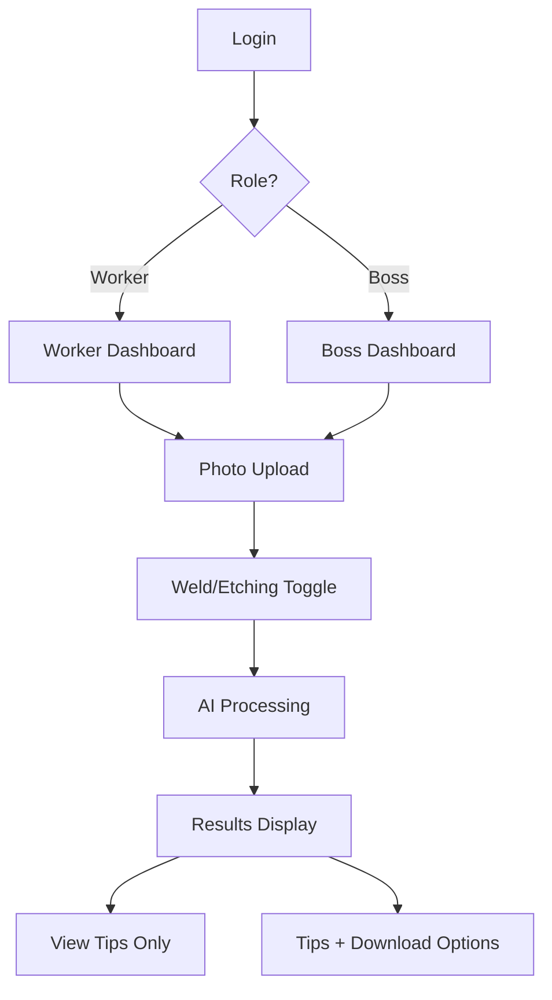

# Design Document

## Overview

The Simplified Mobile Interface transforms the existing AI defect detection system into a consumer-friendly, mobile-first application. The design focuses on maximum simplicity with a 5-page structure: Home/Landing, Login/Sign-Up, Dashboard Main, Share Story, and Reports/Downloads. The interface prioritizes large buttons, minimal text, instant feedback, and seamless Hindi/English language switching to serve welders and fabrication technicians who need quick, reliable quality checks.

## Architecture

### High-Level System Architecture



### Page-Specific Architecture

#### 1. Home/Landing Page Architecture


#### 2. Dashboard Flow Architecture


## Components and Interfaces

### Core Mobile Components

#### 1. Mobile-First Upload Component
```typescript
interface MobileUploadProps {
  mode: 'weld' | 'etching';
  onPhotoCapture: (photo: File) => void;
  isDemo: boolean;
  language: 'en' | 'hi';
}

interface PhotoUploadState {
  isCapturing: boolean;
  isProcessing: boolean;
  progress: number;
  error?: string;
  result?: QuickResult;
}

interface QuickResult {
  status: 'safe' | 'fix' | 'review';
  score: number;
  tip: string;
  carbonSaved: number;
  moneySaved: number;
  benchmark: BenchmarkData;
}
```

#### 2. Language Toggle Component
```typescript
interface LanguageToggleProps {
  currentLanguage: 'en' | 'hi';
  onLanguageChange: (lang: 'en' | 'hi') => void;
  position: 'header' | 'floating';
}

interface TranslationService {
  translate: (key: string, language: 'en' | 'hi') => string;
  translateBulk: (keys: string[], language: 'en' | 'hi') => Record<string, string>;
  loadLanguagePack: (language: 'en' | 'hi') => Promise<void>;
}
```

#### 3. Big Button Component System
```typescript
interface BigButtonProps {
  variant: 'primary' | 'demo' | 'upload' | 'result';
  size: 'large' | 'xlarge';
  icon?: IconType;
  children: React.ReactNode;
  onClick: () => void;
  disabled?: boolean;
  loading?: boolean;
}

// Button sizes optimized for mobile touch
const ButtonSizes = {
  large: 'min-h-[60px] text-lg px-6',
  xlarge: 'min-h-[80px] text-xl px-8'
};
```

#### 4. Results Card Component
```typescript
interface ResultsCardProps {
  result: QuickResult;
  showBenchmark: boolean;
  showCarbonSavings: boolean;
  language: 'en' | 'hi';
  userRole: 'worker' | 'boss';
}

interface BenchmarkData {
  userScore: number;
  industryAverage: number;
  improvement: number;
  ranking: 'excellent' | 'good' | 'average' | 'needs_improvement';
}
```

### Page-Specific Components

#### 1. Home Page Components
```typescript
interface HeroSectionProps {
  language: 'en' | 'hi';
  onDemoStart: (type: 'weld' | 'etching') => void;
  onSignUpClick: () => void;
}

interface DemoModeHandler {
  startDemo: (type: 'weld' | 'etching') => void;
  processDemo: (photo: File, type: 'weld' | 'etching') => Promise<QuickResult>;
  checkDemoLimit: () => { remaining: number; canUse: boolean };
  encourageSignup: () => void;
}
```

#### 2. OTP Login Components
```typescript
interface OTPLoginProps {
  onLoginSuccess: (user: UserProfile) => void;
  language: 'en' | 'hi';
}

interface UserProfile {
  id: string;
  phone: string;
  role: 'worker' | 'boss';
  language: 'en' | 'hi';
  joinDate: Date;
  totalChecks: number;
  totalSavings: number;
}

interface OTPService {
  sendOTP: (phoneOrEmail: string) => Promise<{ success: boolean; message: string }>;
  verifyOTP: (phoneOrEmail: string, otp: string) => Promise<{ success: boolean; user?: UserProfile }>;
  resendOTP: (phoneOrEmail: string) => Promise<{ success: boolean; waitTime: number }>;
}
```

#### 3. Dashboard Components
```typescript
interface DashboardProps {
  user: UserProfile;
  onPhotoUpload: (photo: File, mode: 'weld' | 'etching') => void;
  language: 'en' | 'hi';
}

interface ModeToggleProps {
  currentMode: 'weld' | 'etching';
  onModeChange: (mode: 'weld' | 'etching') => void;
  language: 'en' | 'hi';
}

interface CarbonSavingsDisplay {
  totalCO2Saved: number;
  moneySaved: number;
  treesEquivalent: number;
  monthlyTrend: number[];
}
```

#### 4. Share Story Components
```typescript
interface ShareStoryModalProps {
  isOpen: boolean;
  onClose: () => void;
  onSubmit: (story: UserStory) => void;
  language: 'en' | 'hi';
}

interface UserStory {
  photo?: File;
  description: string;
  problemType: string;
  isAnonymous: boolean;
  allowAITraining: boolean;
}

interface CommunityService {
  submitStory: (story: UserStory) => Promise<{ success: boolean; unlocked: string[] }>;
  getCommunityTips: (defectType: string) => Promise<CommunityTip[]>;
  unlockFeatures: (userId: string, features: string[]) => Promise<void>;
}
```

#### 5. Reports Page Components (Boss Only)
```typescript
interface ReportsPageProps {
  user: UserProfile;
  language: 'en' | 'hi';
}

interface MonthlyReportData {
  month: string;
  passRate: number;
  totalChecks: number;
  moneySaved: number;
  co2Saved: number;
  trends: TrendData[];
  topIssues: DefectSummary[];
}

interface ReportGenerator {
  generateMonthlyPDF: (month: string, userId: string) => Promise<Blob>;
  generateAuditReport: (dateRange: DateRange, userId: string) => Promise<Blob>;
  emailReport: (reportBlob: Blob, email: string) => Promise<boolean>;
}
```

## Data Models

### Simplified User Model
```typescript
interface SimpleUser {
  id: string;
  phone: string;
  role: 'worker' | 'boss';
  language: 'en' | 'hi';
  createdAt: Date;
  lastActive: Date;
  
  // Usage tracking
  totalChecks: number;
  checksThisMonth: number;
  totalSavings: number;
  co2Saved: number;
  
  // Demo tracking
  demoChecksUsed: number;
  demoResetDate: Date;
}
```

### Quick Analysis Result
```typescript
interface QuickAnalysis {
  id: string;
  userId: string;
  photoUrl: string;
  mode: 'weld' | 'etching';
  
  // Simple results
  status: 'safe' | 'fix' | 'review';
  confidence: number;
  tip: string;
  
  // Savings calculation
  carbonSaved: number;
  moneySaved: number;
  timesSaved: number;
  
  // Benchmarking
  userScore: number;
  industryAverage: number;
  
  createdAt: Date;
  isDemo: boolean;
}
```

### Offline Storage Model
```typescript
interface OfflineData {
  pendingUploads: PendingUpload[];
  cachedResults: QuickAnalysis[];
  userPreferences: UserPreferences;
  languagePack: Record<string, string>;
}

interface PendingUpload {
  id: string;
  photo: Blob;
  mode: 'weld' | 'etching';
  timestamp: Date;
  retryCount: number;
}
```

## Error Handling

### Mobile-Specific Error Handling

#### 1. Network Connectivity
```typescript
interface ConnectivityHandler {
  detectOffline: () => boolean;
  queueForSync: (data: any) => void;
  syncWhenOnline: () => Promise<void>;
  showOfflineIndicator: () => void;
}
```

#### 2. Camera/Photo Errors
```typescript
interface PhotoErrorHandler {
  handleCameraPermission: () => Promise<boolean>;
  handleLowLight: () => string; // Returns tip message
  handleBlurryPhoto: () => string;
  handleUnsupportedFormat: () => string;
  suggestRetake: (reason: string) => void;
}
```

#### 3. Processing Errors
```typescript
interface ProcessingErrorHandler {
  handleTimeout: () => void; // Show "Taking longer than usual" message
  handleModelLoadError: () => void; // Fallback to cloud processing
  handleInsufficientMemory: () => void; // Reduce image quality
  showProcessingTips: () => void; // "AI is thinking..." with tips
}
```

## Testing Strategy

### Mobile-First Testing Approach

#### 1. Touch Interface Testing
- **Touch Target Size**: Minimum 44px touch targets for accessibility
- **Gesture Testing**: Swipe, pinch, tap interactions
- **Orientation Testing**: Portrait/landscape mode switching
- **Device Testing**: Various screen sizes and resolutions

#### 2. Performance Testing
- **Load Time**: Page load under 3 seconds on 3G
- **Image Processing**: Under 10 seconds for typical photos
- **Offline Functionality**: Seamless offline/online transitions
- **Battery Usage**: Minimal battery drain during processing

#### 3. Language Testing
- **Translation Accuracy**: Hindi/English content verification
- **Text Layout**: Proper text rendering in both languages
- **Voice Features**: Speech recognition in both languages
- **Cultural Appropriateness**: UI elements suitable for Indian users

#### 4. User Experience Testing
- **One-Handed Usage**: All features accessible with thumb
- **Elderly Users**: Large text and simple navigation
- **Low Literacy**: Icon-based navigation with minimal text
- **Network Conditions**: 2G/3G/4G performance testing

### Demo Mode Testing
```typescript
interface DemoTestSuite {
  testDemoLimits: () => void; // 3 checks per day limit
  testDemoToSignupFlow: () => void; // Conversion funnel
  testDemoResults: () => void; // Realistic but limited results
  testDemoReset: () => void; // Daily limit reset functionality
}
```

### Accessibility Testing
- **Screen Reader**: VoiceOver/TalkBack compatibility
- **High Contrast**: Visibility in bright sunlight
- **Large Text**: Support for system text size settings
- **Color Blind**: Red/green status indicators with icons

The testing strategy ensures the app works reliably for its target users: welders and fab techs who need quick, simple, and reliable quality checks on mobile devices in industrial environments.